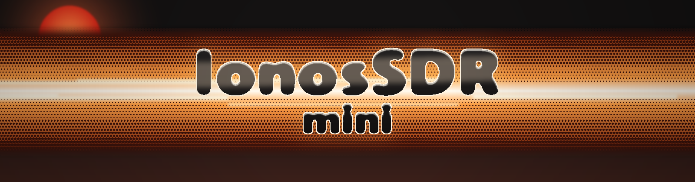
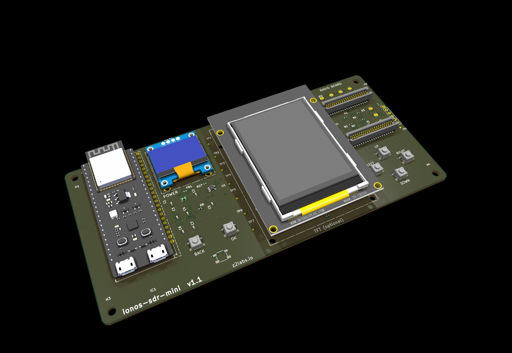
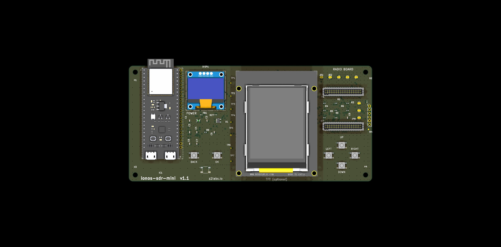
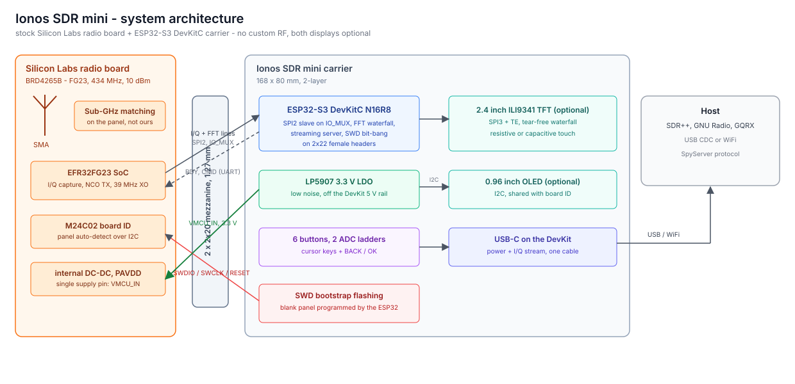
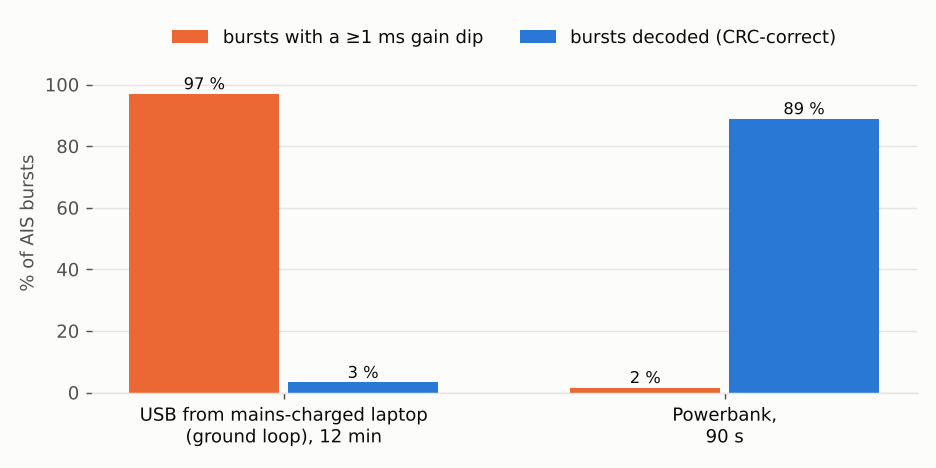
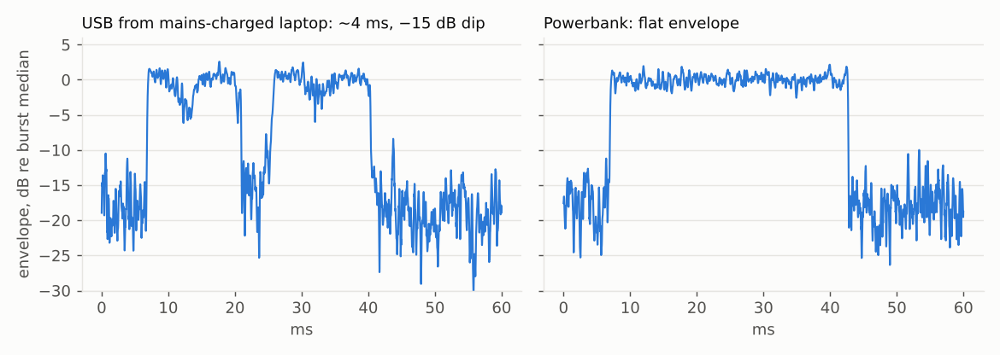
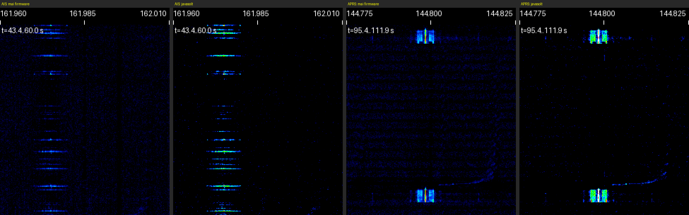

# Ionos SDR mini



Simplified, low-cost sibling of [Ionos SDR](https://github.com/ionos-sdr/ionos-sdr): a carrier PCB that turns a stock Silicon Labs radio board into a usable SDR. An ESP32-S3 DevKitC sits on female headers on the left, a Silicon Labs radio board plugs into the mezzanine socket on the right, and both displays are optional. No custom RF design, no exotic parts ÔÇö the radio board you already have in a drawer does the RF.



*v1.1, 4 layers. KiCad 10 ray-traced render: DevKitC on headers, SSD1306 OLED with BACK/OK below it, the optional ER-TFTM024-3 TFT on a 2x20 socket in the middle (manufacturer's 3D model), cursor keys and the radio board connectors on the right. The render shows the shrouded Samtec TFC model; the JLC build uses the unshrouded TFM-120-02-L-D-K-TR on the same footprint.*



**Status: v1.1 (4-layer) designed, not built yet.** The built and measured board is rev-B3 2L (tag [`rev-b3-2l`](https://github.com/ionos-sdr/ionos-sdr-mini/tree/rev-b3-2l)) — ≈ 86 hours of measurements plus over-the-air receive tests ([Measurements](#measurements)). The firmware lives in the [main repository](https://github.com/ionos-sdr/ionos-sdr); this repo holds the carrier board, its documentation and its measurements.

## What it is

- **Carrier only.** 168 x 80 mm, 4-layer (JLC04161H-7628: F.Cu parts + GND / In1 solid GND / In2 power + signals, horizontal / B.Cu signals, vertical + GND), four M3 nylon standoffs. No RF layout risk: matching network, SMA and shielding stay on the Silicon Labs radio board. Earlier revisions: rev-B3 2L (built and measured, tag `rev-b3-2l`) and rev-B3 4L (branch `layout/rev-b3`).
- **Any radio board fits.** The mezzanine pair is the standard WSTK radio board interface, so BRD4265B (FG23, 434 MHz, 10 dBm) is only the first panel. The pin-to-signal mapping differs per panel and is selected in firmware.
- **Panel auto-detect.** The radio board's M24C02 board-ID EEPROM sits on the same I2C bus as the OLED, so the firmware can read which panel is plugged in and load the matching pin map at boot.
- **Bootstrap flashing.** SWDIO, SWCLK, SWO and RESET are routed to the ESP32, which bit-bangs SWD. A blank radio board can be programmed with nothing but this board and a USB cable; routine updates then go over the UART command link. For a J-Link or Simplicity Link there is also a 1x6 2.54 mm SWD footprint (CON3) on the right edge.
- **One cable.** Power and data over the DevKit's USB-C. The radio gets its own low-noise LDO from the 5 V rail, not the DevKit's shared 3.3 V.

## Architecture



- **RX**: FG23 I/Q capture and server-side FFT lines over SPI2 (IO_MUX) to the ESP32-S3, then to the host or to the on-board display.
- **Control**: RDY handshake and a UART command link; SWD is bit-banged by the ESP32 so a blank panel can be programmed with nothing but this board.
- **Power**: a single low-noise LDO feeds VMCU_IN; the radio board's own DC-DC handles PAVDD, so one supply pin powers the whole panel.

## Hardware

| Block | Part | Notes |
| --- | --- | --- |
| MCU | ESP32-S3-DevKitC-1 or the AliExpress clone | On 1x22 female headers (JLC-fitted), antenna end overhanging the board edge; see [DevKit: clone or official](#devkit-clone-or-official) |
| Radio | Silicon Labs radio board | 2x 2x20, 1.27 mm mezzanine, 24 mm apart; BRD4265B validated first |
| Display (optional) | EastRising ER-TFTM024-3, 2.4", ILI9341 | 240x320, TE pin wired for tear-free hardware scroll; resistive or capacitive touch |
| Display (optional) | SSD1306 0.96" OLED, I2C | Status line when the large display is not fitted |
| Buttons | 6+1 tactile, C&K PTS647 | UP/DOWN/LEFT/RIGHT plus BACK/OK, a seventh SPARE footprint (key optional); two resistor ladders |
| Debug (optional) | 1x6 2.54 mm SWD footprint, CON3 | Not fitted; pogo clip or solder-in pins, see below |
| Radio supply | LP5907-3.3 or TPS7A2033 | ~6.5 uVrms, fed from the DevKit 5 V rail, ferrite + 10 uF at the connector |

Seven keys cost two pins, not seven: both ladders use the same 10 k pull-up and the same 0 R / 2.2 k / 6.8 k / 22 k set to GND (UP/DOWN/LEFT/RIGHT on GPIO2, BACK/OK/SPARE on GPIO1, the 22 k level of that ladder left free), read on ADC1 with a 1 k + 100 nF filter at the pin. One threshold table serves both: 0.30 / 0.97 / 1.80 / 2.79 V. Only the 0 R keys (UP, BACK) can wake the chip from deep sleep. The freed GPIOs carry the SWD lines.

## Pin mapping (BRD4265B)

The EXP header numbers come from the Silicon Labs radio board documentation; the connector pins are what you actually route. For EXP 3 to 16 the P201 pin number equals the EXP number.

| Signal | ESP32-S3 GPIO | FG23 pin | WSTK net | Connector pin |
| --- | --- | --- | --- | --- |
| SCLK | 12 (SPI2 IO_MUX) | PC05 | WSTK_P12 | P201-15 |
| MOSI | 11 (SPI2 IO_MUX) | PC00 | WSTK_P7 | P201-10 |
| CS | 10 (SPI2 IO_MUX) | PA07 | WSTK_P10 | P201-13 |
| RDY | 14 | PD02 | WSTK_P6 | P201-9 |
| CMD | 13 (UART TX) | PA06 | WSTK_P8 | P201-11 |
| SWDIO | 38 | PA02 | WSTK_P18 | P201-21 |
| SWCLK | 39 | PA01 | WSTK_P20 | P201-23 |
| SWO | 47 | PA03 | WSTK_P16 | P201-19 |
| RESETn | 40 | RESETn | WSTK_F4 | P200-17 |
| BOARD_ID_SDA / SCL | 41 / 42 (I2C0) | - | BOARD_ID | P200-40 / P200-39 |
| VMCU_IN | - | - | VMCU_IN | P201-2 |
| 3V3 | - | - | 3V3 | P200-1 |
| GND | - | - | GND | P200-2, 38; P201-1, 39 |

The FG23 link runs on SPI2 through the IO_MUX pins so the slave interface keeps its headroom for higher clocks; the optional TFT is on SPI3. `VRF` is unused on BRD4265B and the on-board DC-DC feeds PAVDD, so a single supply pin powers the whole panel; P201-40 (VRF_IN) only runs to test point TP8, and P200-37 (5 V) has a not-fitted 0 R (R33) from the DevKit 5 V for panels that need it.

## Display and touch

The ER-TFTM024-3 sits on SPI3 (SCK 4, MOSI 5, MISO 6, CS 7, D/C 15, RST 16, BL 17, TE 18). Its resistive touch controller (XPT2046) and the module's optional SD/font/flash chips share a second header bus (pins 32/33/34), which is tied to the TFT bus on the carrier; the touch transactions run at their own ~2 MHz clock. 10 k pull-ups hold the module's SD/FONT/FLASH chip selects (header 35/36/37) inactive so nothing else drives MISO.

| Pin | Resistive (XPT2046) | Capacitive (I2C CTP) |
| --- | --- | --- |
| TCH_A, GPIO8, header 30 | SPI CS | I2C SCL |
| TCH_B, GPIO21, header 31 | PENIRQ | I2C SDA |
| TCH_INT, GPIO9, header 39 | unused | CTP INT |

Both 4.7 k pull-ups (TCH_A, TCH_B) are fitted in every build, so one BOM serves both panel types; firmware picks the mode. **Before the first power-up**, measure the panel's MISO/TE high level with VDD = 5 V: if it follows 5 V, run the panel from 3V3 or add level shifting.

## DevKit: clone or official

The two boards do not share the same header spacing. On the Espressif ESP32-S3-DevKitC-1 the two pin rows are 22.86 mm apart. The AliExpress clone is wider: its PCB is 28.3 mm, and its rows are 25.4 mm apart.

Since v1.1 the footprint has both right-hand rows:
- J1 (left) is shared.
- J3 has two rows of holes, 2.54 mm apart, joined by copper.
- The silkscreen shows both outlines (the clone's dashed) and marks the two spacings, "DevKitC-1 22.86" and "clone 25.40", under the module.

JLC fits the female headers:

| Header | Row | Fitted |
| --- | --- | --- |
| J10 | J1 (shared) | always |
| J11 | clone J3 | default |
| J12 | DevKitC-1 J3 | not fitted (DNP); fit it instead of J11 for an Espressif board |

The RGB LED is on GPIO48 on the clone and on DevKitC-1 v1.0, and on GPIO38 on DevKitC-1 v1.1. The SWD lines avoid GPIO48: since v1.1 SWO is on **GPIO47**, SWDIO stays on GPIO38. With a DevKitC-1 v1.1 the LED sits on SWDIO, flickers during SWD and loads the line, so remove the LED or its series resistor, or use the clone or a v1.0 board.

## Changes in v1.1

- DevKit footprint with two J3 rows (clone 25.4 mm and DevKitC-1 22.86 mm), J10-J12 female headers in the JLC BOM (Hong Cheng HC-PM254-8.5H-1x22PZ, THT).
- SWO moved from GPIO48 to GPIO47 (GPIO48 drives the clone's RGB LED).
- OLED: four 2.5 mm plated holes for the module's mounting lugs, and the outline per the module drawing (27.3 x 27.3 mm).
- TFT socket is SMD (HCTL PM254-2-20-S-8.5, 8.5 mm), assembled by JLC.
- Layer roles: In1 is solid GND, as the reference for the top layer. In2 carries the power and most signals, routed horizontally (89 % of its length); B.Cu takes the vertical runs (79 %). The top layer holds only the parts' escapes (153 mm). The board was fully re-routed and GND-stitched.

## SWD debug header

CON3 is a 1x6 2.54 mm row of plated holes on the right edge, outside the radio board's outline, so it stays reachable with the radio board plugged in. Pin order follows the Tag-Connect TC2030-CTX:

| Pin | 1 | 2 | 3 | 4 | 5 | 6 |
| --- | --- | --- | --- | --- | --- | --- |
| Signal | VTref (VMCU) | SWDIO | nRESET | SWCLK | GND | SWO |

The pins connect on the radio side of the solder-jumper cut points. With a debugger attached, either keep the ESP32's SWD pins as inputs in firmware or cut JP2 and JP6-JP8 to detach the ESP32 completely. VTref only senses the radio board's VMCU; the debugger must not power the board through it.

## Measurements

All measurements so far are on **rev-B3 2L** + BRD4265B, the board that was built (tag [`rev-b3-2l`](https://github.com/ionos-sdr/ionos-sdr-mini/tree/rev-b3-2l)); v1.1 has not been built yet.

**Time on test so far: Ôëł 86 hours** (rev-B3 2L + BRD4265B, 2ÔÇô9 Nov 2026): Ôëł 54 h RF with a calibrated signal generator, Ôëł 32 h USB-only soaks.
Full report: [`docs/ionos-mini-measurements-2026-11.md`](docs/ionos-mini-measurements-2026-11.md) ([magyarul](docs/hu/ionos-mini-meresi-jelentes-2026-11.md)) ┬Ě raw data and scripts: [`measurements/ionos-mini-2026-11/`](measurements/ionos-mini-2026-11/).

| BRD4265B (434 MHz match), measured at 145 MHz | |
|---|---|
| I/Q over USB (TinyUSB CDC on USBÔÇĹOTG) | 200 ksps int16 (813 kB/s); 40 h: 86 M blocks, 0 device drops, 0.65 ppm host loss |
| Gain / clipping | dBFS = P_in + 53.68 dB (¤â 0.10 dB over 40 h), clip Ôëł Ôłĺ52 dBm |
| NF / MDS | Ôëł 8.6 dB / Ôëł Ôłĺ128 dBm (10 dB SNR, 500 Hz) |
| 200 ksps bandwidth / image rejection | 88 kHz at Ôłĺ3 dB (PHY channel filter) / Ôëą 42 dB |
| Frequency | crystal +4.2 ppm raw (firmware correction currently over-corrects to Ôłĺ11 ppm), 1.9 ppm pÔÇĹp diurnal |
| Tuning range with the 145 MHz PHY | 128.34 ÔÇô 198.07 MHz; CW NF 7.9 ÔÇô 11.9 dB across it |
| 2ÔÇĹFSK 5 kbps, BER 10Ôü╗┬▓ | median Ôłĺ110 dBm (simple discriminator reference) |
| SoapySDR | SoapyIonos driver works on Windows (GQRX, SoapySDRUtil, Python); 3.25 M blocks in the sweeps, 4 lost |
| Known artefact | ┬▒6.25 kHz sidebands (Ôłĺ74 dBc at 5 kHz, Ôłĺ43 dBc at 37 kHz tone offset) from the I/Q path ÔÇö open |

### Receive tests, 22 Nov 2026 ÔÇö APRS, AIS, ground loop

Over the air at home (Budapest, ~1 km from the Danube), magÔÇĹmount 2 m whip on a radiator. Details: [`measurements/ionos-mini-2026-11-22-rx/`](measurements/ionos-mini-2026-11-22-rx/RESULT.md).

| | |
|---|---|
| APRS 144.800, onÔÇĹdevice AFSK demod | channel FIR before the discriminator: 20 of 20 bursts on a 20ÔÇĹmin capture (old firmware 0); ~25 packets/h gated live |
| AIS 161.975 (channel A), onÔÇĹdevice GMSK demod | battery supply: 56 of 63 bursts (89 %); live 70 min: 788 messages, 82 stations (64 river AtoN, 14 vessels); NMEA on TCP 10110 |
| AIS perÔÇĹpacket level / SNR / offset | Ôłĺ46 ÔÇŽ Ôłĺ36 dBFS, SNR 9ÔÇô25 dB (median 15), ┬▒600 Hz |
| **Ground loop** (mainsÔÇĹcharged laptop USB + antenna on a radiator, no PE in the house) | 12ÔÇô17 dB gain dips, 2ÔÇô4 ms, every 20 ms: AIS 13 of 398 bursts, APRS dead after dark. **Use a battery or isolate the USB.** |

<p align="center"></p>
<p align="center"></p>
<p align="center"></p>
<p align="center"><i>OnÔÇĹdevice TFT waterfall (PC emulator of the firmware): old vs new ÔÇö perÔÇĹbin peak of the 3 FFTs per row, 24 dB range, DC patch ┬▒1 bin.</i></p>

## Manufacturing files

Gerbers, drill, JLCPCB BOM and CPL are attached to the GitHub release [`rev-b3-4l-20261022`](https://github.com/ionos-sdr/ionos-sdr-mini/releases/tag/rev-b3-4l-20261022), not committed. To rebuild them from the KiCad project (DRC and schematic parity must be clean, or nothing is written):

```
"C:\Program Files\KiCad\10.0\bin\python.exe" fab/jlc_pack.py
```

JLC assembles the top-side SMD parts, the two radio board connectors, the TFT socket and the DevKit headers (J10 + J11 for the clone by default); the DevKit, the displays and the debug header are fitted by hand. The manufacturing files for v1.1 have not been released yet; the release above is rev-B3 4L, and the built 2L board's files are in [`rev-b3-2l-jlc-20261022`](https://github.com/ionos-sdr/ionos-sdr-mini/releases/tag/rev-b3-2l-jlc-20261022). LCSC part numbers are in `fab/jlc_lcsc.csv`.

## Repository

```
hardware/          KiCad project, fab outputs, BOM           CERN-OHL-P-2.0
docs/              pin mapping, assembly notes, renders      CC-BY-4.0
measurements/      raw data, scripts, results                CC-BY-4.0
```

Firmware lives in the [main repository](https://github.com/ionos-sdr/ionos-sdr): `firmware-fg23/` for the radio SoC, `firmware-esp32/` for the companion.

## Credits, licensing, trademarks

Hardware under CERN-OHL-P-2.0, documentation under CC-BY-4.0. Not affiliated with IONOS SE or Silicon Laboratories; EFR32, Simplicity Studio and the WSTK radio board interface are Silicon Labs property, used here for interoperability only.

Designed by Zoltán Dóczi and Zoltán Papp at [Z2 Labs](https://www.z2labs.io/), Budapest. Design and manufacturing support by [Protowoerk](https://www.protowoerk.com).
