# ionos-sdr-mini — receiver datasheet (measured)

**Unit:** ionos-sdr-mini rev-B3 2L + Silicon Labs BRD4265B radio board (EFR32FG23, 434 MHz / +10 dBm match), ESP32-S3, 16-bit I/Q over USB.
**Firmware:** [`ionos-sdr/ionos-sdr`](https://github.com/ionos-sdr/ionos-sdr) `board/ionos-mini-idf` @ `2646be2` (per-divider tuning, `FREQ_CORR_RX_PPB` = +4200). **Host:** [SoapyIonos](https://github.com/ionos-sdr/SoapyIonos).
**Measured:** 2–16 Nov 2026, **≈ 167 h on test**. Raw data, scripts and logs: [`measurements/ionos-mini-2026-11/`](../measurements/ionos-mini-2026-11/).

These are measurements of **one unit** at room temperature (not a temperature chamber), **not** guaranteed limits. "Typical" means the median of all repeats.

**Measurement conditions.**
- Signal source: Signal Hound VSG60 → long coax → 30 dB pad → BRD4265B SMA.
- P_in = VSG level − 30 dB. **The coax loss is not subtracted**: at 1 GHz and above the real input-referred values are a few dB better than listed.
- 200 ksps, 32 k FFT unless noted. MDS is for 10 dB SNR in 500 Hz.
- 2-FSK figures use a simple non-coherent discriminator as a reference demodulator: 5 kbps, ±2.5 kHz, PRBS9, 50 ksps.

---

## 1. Specifications

### 1.1 General

| Parameter | Value |
|---|---|
| Tuning range (firmware, per-divider VCO windows) | **97 – 1562 MHz** and **2025 – 3100 MHz** |
| Not covered | 1562 – 2025 MHz: no LO divider; the VCO edges are excluded so the synthesiser cannot hang |
| Lock verified (on-board 39 MHz comb seen at the expected offset) | 117 – 3081 MHz |
| LO dividers used | 1–10, 12, 14, 15, 16, 18, 20, 21, 24. VCO window ≈ 4.05 – 6.25 GHz (per-divider table in firmware) |
| Sample rates | 400 kS/s ÷ R; R = 2 / 4 / 8 / 16 / 24 / 32 / 48 / 64 → **200 / 100 / 50 / 25 / … ksps** |
| Output | 16-bit I/Q, 1040-byte frames (`IQB2`, sequence-numbered) over USB CDC (TinyUSB, USB-OTG) |
| Usable bandwidth | 200 ksps: **88 kHz** (−3 dB, set by the PHY channel filter); 100 ksps: 59 kHz; 50 ksps: 28 kHz |
| Image rejection | ≥ 42 dB (200 ksps), ≥ 46 dB (100 ksps), ≥ 49 dB (50 ksps) — limited by the noise floor |
| Tuning resolution | 1 Hz (`F<kHz>.<Hz>`, SoapySDR `setFrequency`) |
| USB integrity | 40 h at 200 ksps: 86 M blocks, 0 device drops, 0.65 ppm host-side loss. Weekend run: 157 M blocks, 0 lost |

### 1.2 Receiver, per band (typical)

| Frequency | Gain [dB] | NF [dB] | MDS [dBm] | 2-FSK BER 10⁻² [dBm] | P_in at ADC full scale [dBm] |
|---|---|---|---|---|---|
| 102 MHz | 53.5 | 7.4 | −129.6 | — | — |
| 145 MHz (2 m) | 53.1 | 9.0 | −128.0 | −110.3 | −53 |
| 300 MHz | 56.4 | 4.4 | −132.6 | — | −56 |
| **434 MHz (70 cm, matched)** | **63.4** | **4.1** | **−132.9** | **−115.4** | **−62** |
| 500 MHz | 60.1 | 3.5 | −133.5 | — | −59 |
| 700 MHz | 43.5 | 15.4 | −121.6 | — | −41 |
| 868 MHz | 34.9 | 23.5 | −113.5 | −93.5 | −32 |
| 1000 MHz | 29.7 | 28.7 | −108.3 | — | −29 |
| 1296 MHz (23 cm) | 16.1 | 42.1 | −94.9 | −73.4 | > −20 |
| 1500 MHz | 1.9 | 56.8 | −80.2 | — | > −20 |
| 2400 MHz (13 cm) | 2.0 | 55.2 | −81.8 | −54.5 | > −20 |
| 3000 MHz | 12.4 | 45.2 | −91.8 | −58.6 | > −20 |

- Gain is tone dBFS − P_in.
- The values at the 12 reference frequencies are medians of 2239 repeats over 52 h.
- The 1 MHz grid over the whole range is shown in chart 24.

### 1.3 Spurious performance

| Parameter | Value |
|---|---|
| Spurious response, RX at 434 MHz, input swept 30 MHz – 6 GHz at −20 dBm | worst **−70 dBc** (11 × LO, 4775 MHz); all others ≤ −104 dBc; no image response found |
| Spurious response, RX at 868 MHz | worst −81 dBc (1085 MHz); others ≤ −89 dBc |
| Spurious response, RX at 145 MHz | not determinable: dominated by the VSG60's own output spurs |
| Residual (self-generated) responses, input terminated | at k × 19.5 / 39 MHz (FG23 clocks) and k × 40 MHz (ESP32 crystal, below ~1.5 GHz), up to ~33 dB above the noise in 100 – 650 MHz; few above 1 GHz |
| Two-tone, ±10 kHz | no 3:1 third-order product rises above the fixed spur floor before the ADC clips. The ADC clip, not IIP3, limits the dynamic range |
| Close-in noise around a strong tone (VSG60 + receiver) | ≤ −96 dBc/Hz (145 MHz), ≤ −100 … −104 dBc/Hz (434 MHz) at 1 – 30 kHz offset; limited by the measurement noise floor |
| ±6.25 kHz sidebands of a tone (I/Q-path timing, open item) | −74 dBc at 5 kHz, −51 dBc at 20 kHz tone offset |

### 1.4 Frequency and stability

| Parameter | Value |
|---|---|
| Crystal error, uncorrected | +2.3 … +5.35 ppm over the weekend; follows the room temperature, the same on every divider |
| Firmware correction | fixed +4.2 ppm (`FREQ_CORR_RX_PPB`). Residual over the weekend −1.9 … +1.15 ppm → a TCXO is planned |
| Gain stability, 52 h | σ 0.04 – 0.07 dB below 1 GHz; 0.24 – 0.27 dB at 1.3 – 1.5 GHz (steep match slope) |
| NF stability, 52 h | σ ≤ 0.13 dB below 1 GHz |

---

## 2. Typical characteristics

All charts are in [`measurements/ionos-mini-2026-11/charts/`](../measurements/ionos-mini-2026-11/charts/).

**Gain, NF and MDS, 97 – 3100 MHz, 1 MHz grid (2483 points)**

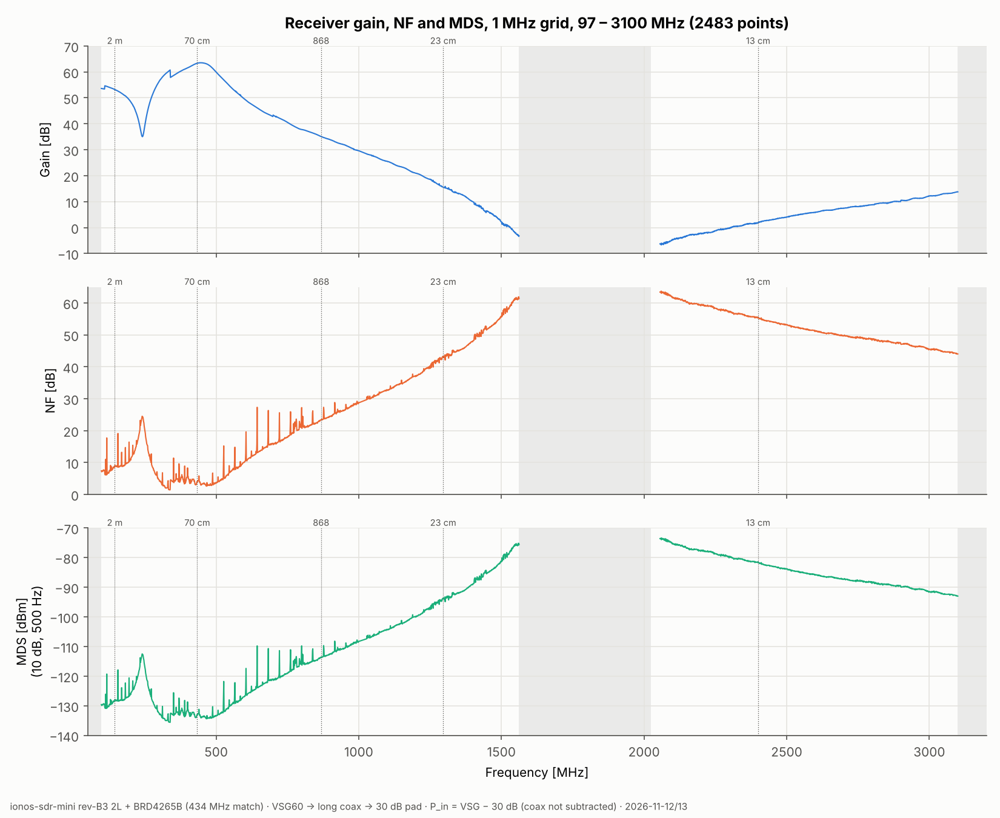

- The 434 MHz RX match is a single series 82 nH inductor resonating with the ~1.2 pF, high-impedance LNA input, and it shares the node with the TX LC low-pass.
- That gives voltage gain around 434 MHz (NF 3–4 dB), and a falling response above ~600 MHz.
- The notch near 245 MHz is a resonance of the same network.
- The chip itself tunes and locks to 3.1 GHz (chart 10).

**2-FSK sensitivity every 25 MHz, and BER curves**

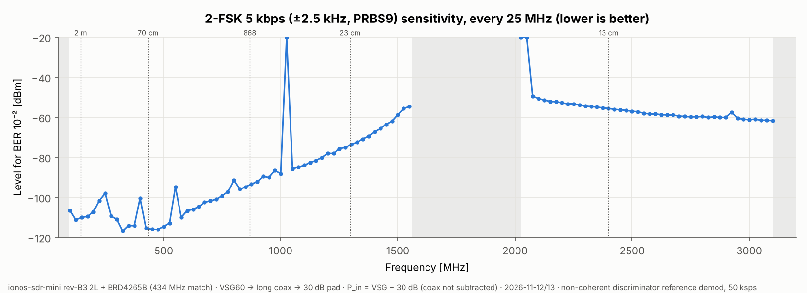
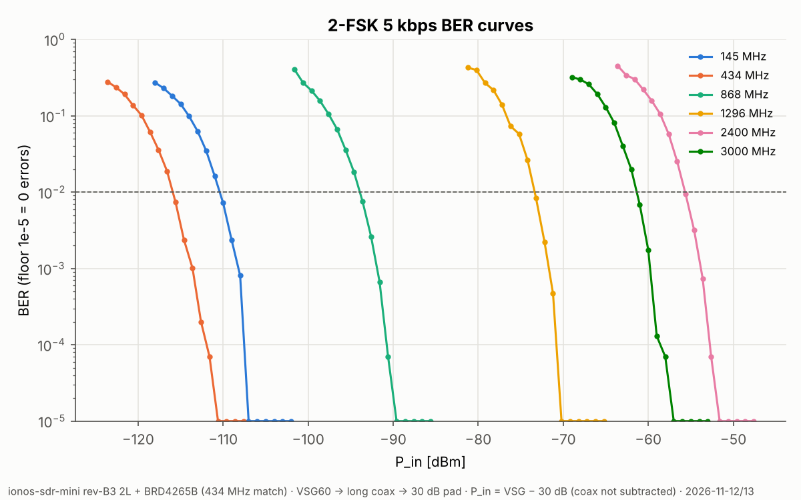

**Linearity and clip point**

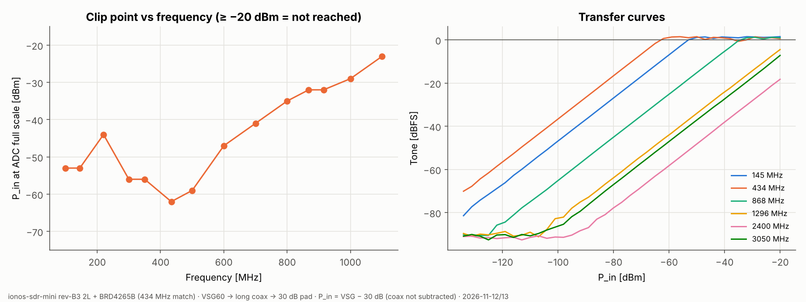

**Spurious responses (RX fixed, input swept 30 MHz – 6 GHz)**

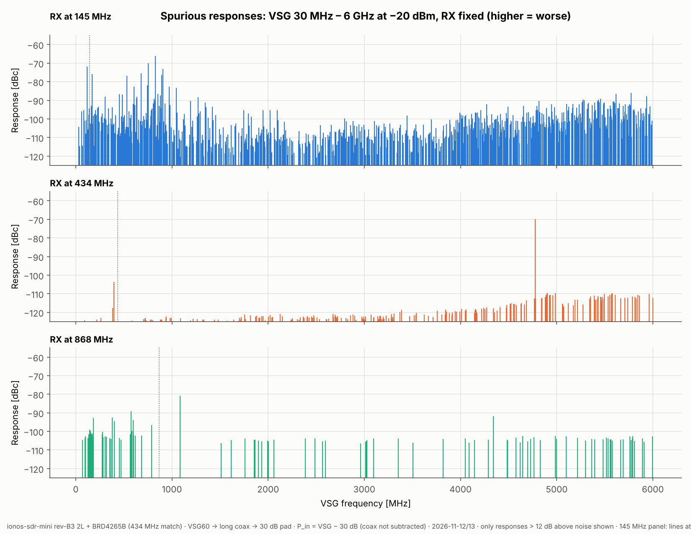

**Two-tone test**

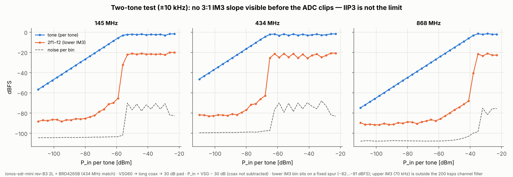

**Stability over the weekend**

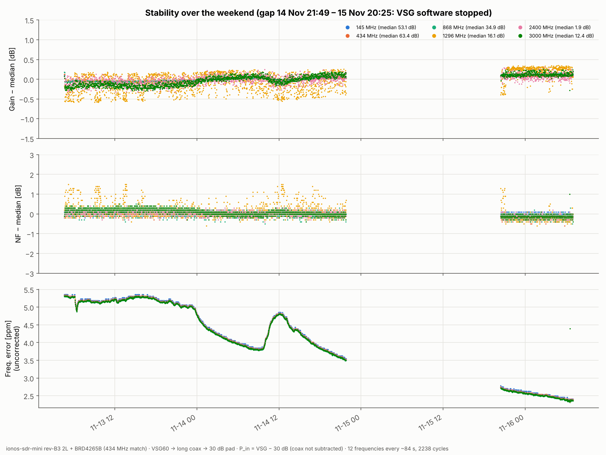

**Coverage proof with the on-board clock comb, and residual spurs with a terminated input**

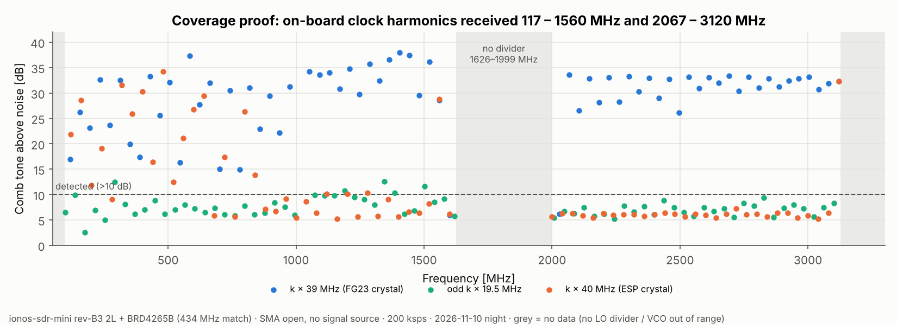
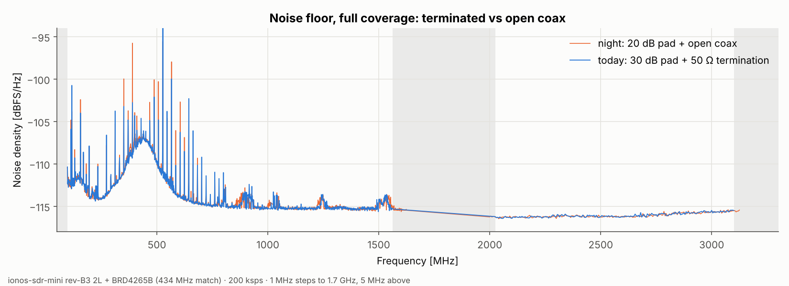
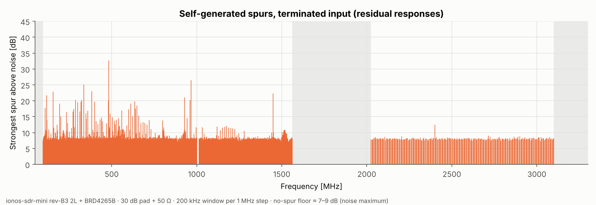

**At 145 MHz in detail: passband and image, linearity, 40 h drift**

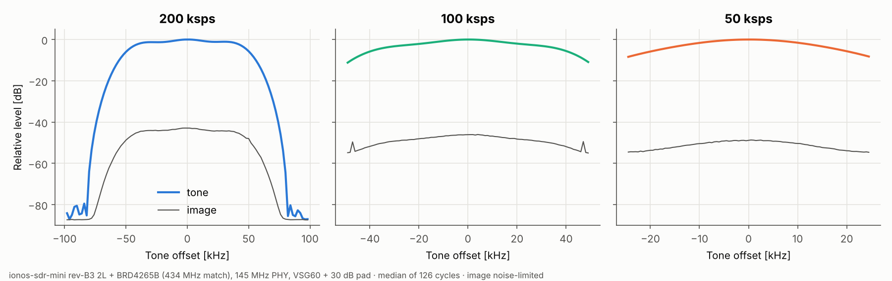
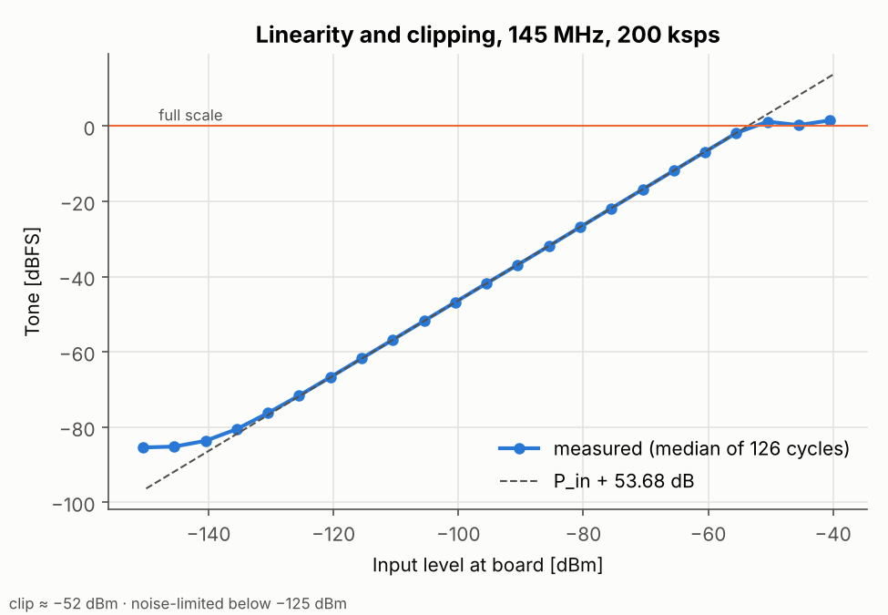
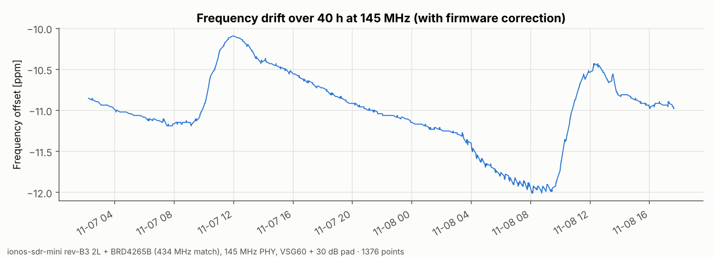

---

## 3. Limitations and open items

1. **Coax loss not subtracted.** It should be calibrated with the BB60C and the tables corrected above ~1 GHz.
2. **Front end above ~600 MHz.**
   - The BRD4265B match limits it.
   - A wideband version needs a 50 Ω LNA, switched band filters and a short drive into the FG23 input.
   - Preselection is needed anyway, because of the square-wave-LO harmonic responses.
3. **Two-tone redo:** tones and IM3 inside the flat channel band and clear of the fixed spurs; ideally two separate generators.
4. **Phase noise** needs a cleaner reference source than the VSG60.
5. **TX** output power and harmonics versus frequency (BB60C) are still to be measured.
6. **Firmware:**
   - temperature-aware crystal correction (or a TCXO);
   - ESP OK only after the FG23 ack;
   - seamless retune;
   - fix for the ±6.25 kHz sideband source.
