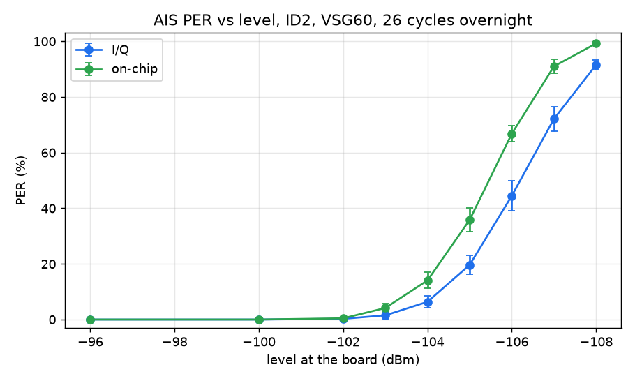
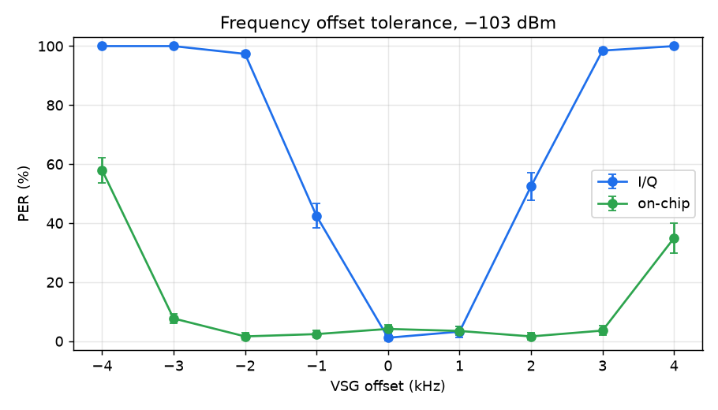

# AIS reception: I/Q path vs FG23 on-chip — 2026-11-23

Two ways the mini receives AIS (both in the same firmware, switched by command):

- **IQ** — the FG23 streams I/Q (`RX_IQDATA_FILTLSB`, 50 ksps around 161.985 MHz)
  over SPI, the ESP32 demodulates channel A in software (`ais_rx.c`).
- **native / HW** — the FG23 runs its own AIS PHY (2GFSK 9600 bd, LEGACY demod),
  the frame controller finds the sync word, `ais_hw.c` does NRZI/HDLC/CRC on the
  FG23 and sends finished frames in AIS1 blocks. Channel A or B.

Firmware: [`firmware/`](../../firmware/). Description of the native path:
[`docs/fg23-ais-onchip.md`](../../docs/fg23-ais-onchip.md).

Data: [`data/`](data/) (PER sweeps as printed, the overnight CSV so far).
Scripts: [`scripts/`](scripts/) — `ais_gen.py` (waveform), `vsg_per.py` (PER
sweep), `overnight.py` (the whole matrix, repeated), `hw_sess.py` (console log
with a command timeline), `win_count.py` (frames per time bin). VSG60 API:
`vsg_api.dll` from the Signal Hound VSG install.

## Setup (ID2, office)

- ionos-mini **ID2**, RF input cabled.
- Signal Hound **VSG60A** → **40 dB** attenuator → board. Levels below are at the
  board (VSG − 40 dB).
- Waveform: 4 real type-21 AtoN frames (Danube traffic), GMSK BT 0.4, h 0.5,
  9600 bd, ITU ramp-up 8 bits + 24-bit training, **10 bursts/s**, 960 ksps,
  looped. VSG at 161 972 850 Hz (compensates ID2's crystal, ≈ +13.5 ppm).
- 20 s per point (200 bursts), 1.5 s settle not counted.

**Measurement pitfall (fixed):** reading the console with pyserial
`read(4096/8192)` on Windows returns only when the buffer is full — the lines
arrived in ~4.6 s batches and a 20 s window caught 4 or 5 of them, which looked
like a constant ~5 % loss on the native path. Read with
`read(max(1, in_waiting))`; counted continuously, the native path delivers
exactly 10 frames/s at −100 dBm.

## Sensitivity (PER vs level, channel A)

| board dBm | native PER | IQ PER |
|---|---|---|
| −96 | 0 % | 0 % |
| −100 | 0–0.5 % | 0 % |
| −102 | 0.5 % | 0 % |
| −103 | 7.5 % | 0.5–2 % |
| −104 | 15.5–23.5 % | 4–7.5 % |
| −105 | 33–45.5 % | 14–22.5 % |
| −106 | 66–70 % | 39–41 % |
| −107 | 91–93 % | 70.5–71 % |
| −108 | 99–99.5 % | 91.5–94.5 % |

50 % point: **native ≈ −105.3 dBm, IQ ≈ −106.3 dBm** — the I/Q path is ~1 dB
more sensitive on a clean, on-frequency signal.

Channel B (native only, the I/Q window covers A only): −100 dBm 0 %,
−104 dBm 12.5–15 %, −106 dBm 68–70 % — same as A.

## Frequency offset tolerance (−103 dBm)

VSG offset from the compensated channel A frequency:

| offset | native PER | IQ PER |
|---|---|---|
| −4 kHz | 56 % | 100 % |
| −3 kHz | 5.5 % | 100 % |
| −2 kHz | 1 % | 96 % |
| −1 kHz | 0 % | 43.5 % |
| 0 | 5 % | 0 % |
| +1 kHz | 4.5 % | 3.5 % |
| +2 kHz | 1.5 % | 59 % |
| +3 kHz | 6.5 % | 99 % |
| +4 kHz | 37 % | 100 % |

The native path (AFC, 3.24 kHz tolerance in the PHY) takes ±3 kHz; the I/Q
demod only ≈ ±1 kHz. Real transmitters are off by a few hundred Hz to ~1 kHz
and the receiver's own crystal adds to it — this is why the native path keeps
up with (and on live traffic slightly beats) the I/Q path despite the 1 dB.

## CW interferer (signal −100 dBm, CW at offset, dB above the signal)

| CW offset | native: 30 / 40 / 50 / 60 dBc | IQ: 30 / 40 / 50 / 60 dBc |
|---|---|---|
| +25 kHz | 0 / 0 / 0 / 54.5 % | 0 / 0 / **100** / 100 % |
| −25 kHz | 0 / 0 / 0 / 59.5 % | 0 / 0 / **100** / 100 % |
| +50 kHz (channel B) | 0 / 0 / 0 / 100 % | **100 / 100 / 100 / 100 %** |
| +100 kHz | 0 / 0 / 0 / 100 % | 0 / 0 / 0 / 17.5 % |
| −300 kHz | 0 / 0 / 0 / 10.5 % | 0 / 0 / 0 / 2.5 % |

- **IQ path: a carrier on channel B blocks channel A completely**, even at
  +30 dBc. It sits 40 kHz above the I/Q centre and folds onto A in the
  50 ksps stream (decimation alias). Real channel-B traffic does the same to
  the I/Q path. To fix: better anti-alias filtering before the decimation, or
  a wider output rate.
- The native path's channel filter holds up to +50 dBc everywhere tested.
- At 60 dBc the wanted signal sits at −60 dBFS of the VSG — VSG noise and DAC
  spurs may take part; treat the 60 dBc column with care.

## Slot stress (a burst in every AIS slot, 37.5/s, one-slot frames)

| board dBm | native PER | IQ PER |
|---|---|---|
| −96 | 0 % (750/750) | 0 % (750/750) |
| −104 | 9.1 % | 6.1 % |

Back-to-back slots cost nothing on either path: the native re-arm after the
closing flag catches the next slot.

## Live traffic (ID1, home, Danube; `AISBENCH 5`)

Five minutes I/Q, five minutes native, alternating, same antenna. After the
bench's I/Q retune fix: first hour IQ 4.54/min, native 4.71/min (HW/IQ 1.04);
after ~3 h IQ 2.42/min (226 msgs, 19 slots), native 2.76/min (244 msgs, 18
slots), **HW/IQ 1.14**; stations both 67, IQ only 8, native only 14.

## Overnight run (26 cycles, 2026-11-23 18:53 → 11-24 07:57)

Everything above repeated 26 times in 13 h (`scripts/overnight.py`, ~31 min
per cycle, 2118 points): [`data/overnight.csv`](data/overnight.csv),
summary [`data/overnight_summary.txt`](data/overnight_summary.txt), charts by
`scripts/analyze_overnight.py`.

| board dBm | native PER (mean ± sd) | IQ PER (mean ± sd) |
|---|---|---|
| −96 / −100 | 0 % | 0 % |
| −102 | 0.4 ± 0.5 % | 0.3 ± 0.5 % |
| −103 | 4.2 ± 1.5 % | 1.5 ± 1.2 % |
| −104 | 14.1 ± 2.9 % | 6.4 ± 2.2 % |
| −105 | 35.8 ± 4.3 % | 19.6 ± 3.4 % |
| −106 | 66.8 ± 2.8 % | 44.5 ± 5.4 % |
| −107 | 91.0 ± 2.4 % | 72.1 ± 4.3 % |
| −108 | 99.2 ± 0.5 % | 91.6 ± 1.7 % |

**50 % point, per cycle: native −105.45 dBm (sd 0.10, range −105.62…−105.22),
IQ −106.19 dBm (sd 0.17, range −106.40…−105.75)** — a steady 0.74 dB in favour
of the I/Q path on a clean, on-frequency signal; neither path drifted over the
night ([`data/overnight_p50_drift.png`](data/overnight_p50_drift.png)).

Frequency offset at −103 dBm (26 cycles): the native path stays ≤ 7.7 % from
−3 to +3 kHz; the I/Q path is 42 % at −1 kHz and 52 % at +2 kHz, ≥ 97 % beyond
±2–3 kHz. This, not the 0.74 dB, is what decides live reception
(native/IQ 1.21–1.32 on the Danube over the same night, see below).

CW interferer (mean of 26 cycles, 30 / 40 / 50 / 60 dBc):

| CW offset | native | IQ |
|---|---|---|
| +25 kHz | 0 / 0 / 0 / 67 % | 0 / 0.1 / **100** / 100 % |
| −25 kHz | 0 / 0 / 0 / 65 % | 0 / 0 / **100** / 100 % |
| +50 kHz (channel B) | 0 / 0.4 / 0.7 / 100 % | **100 / 100 / 100 / 100 %** |
| +100 kHz | 0 / 0 / 0 / 96 % | 0 / 0 / 0 / 16 % |
| −300 kHz | 0 / 0 / 0 / 16.5 % | 0 / 0 / 0 / 3.1 % |

Every slot busy (37.5 bursts/s): −96 dBm 0 % on both in all 26 cycles;
−104 dBm native 9.4 ± 1.2 %, IQ 6.4 ± 1.1 %. Channel B (native): −100 dBm 0 %,
−104 dBm 13.4 ± 2.8 %, −106 dBm 64.6 ± 3.3 % — same as A.

Reported frequency offset through the night
([`data/overnight_df_drift.png`](data/overnight_df_drift.png)): the I/Q
demod's Δf moved from ~+295 to ~+224 Hz (ID2's crystal warming / cooling in
the office). The native Δf (RAIL's frequency offset estimate, converted with
the I/Q synth step — **not calibrated**, quantised in ~255 Hz steps) moved
from −1356 to −2110 Hz with a step around 06:30; its scale is wrong by a
factor still to be measured, so it is only a relative indicator for now.

### Live, same night (ID1, home, `AISBENCH 5`)

| time | IQ msgs/min | native msgs/min | native / IQ | stations both / IQ only / native only |
|---|---|---|---|---|
| 18:22 | 4.54 | 4.71 | 1.04 | 56 / 7 / 10 |
| 21:29 | 2.16 | 2.85 | 1.32 | 71 / 11 / 13 |
| 02:36 | 1.76 | 2.16 | 1.23 | 76 / 17 / 9 |
| 08:02 | 1.67 (721 msgs, 88 slots) | 2.08 (902 msgs, 88 slots) | **1.25** | 77 / 20 / 8 |

Cumulative since 17:21. Over ~15 h the native path decoded 25 % more
messages; the I/Q path still hears a few more distinct stations (20 vs 8
exclusive) — candidates for the weakest, on-frequency ones.

### Live, full run until the switch to ADS-B (proxy log, 2026-11-25)

[`data/live_bench_2026-11-24.json`](data/live_bench_2026-11-24.json) is the guest-map proxy's
AISBENCH log (23 Nov 21:43 to 24 Nov 12:28, 14.7 h counted, 7.36 h per path): I/Q 597 messages
(81/h), on-chip 742 (101/h), **ratio 1.24**; the on-chip path is ahead in 10 of 13 full hours.
95 stations: 74 heard by both, 20 by I/Q only, 1 by on-chip only. Every I/Q-only station has
exactly one message at -103...-106 dBm reported level, and one of them has a 10-digit (invalid)
MMSI: part of the I/Q-only set are CRC-by-chance decodes, not weak real stations. An MMSI /
plausibility filter is needed on the I/Q path.

Report with charts (EN/HU): [`docs/reports/`](../../docs/reports/); charts and PDF are made by
`scripts/report_charts.py` and `scripts/report_build.py`.